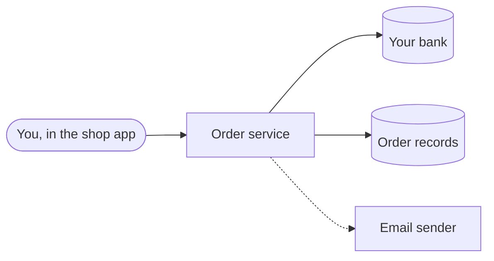
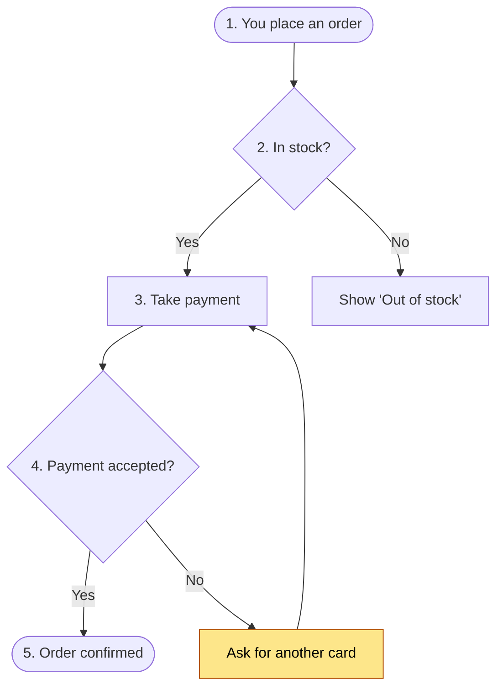
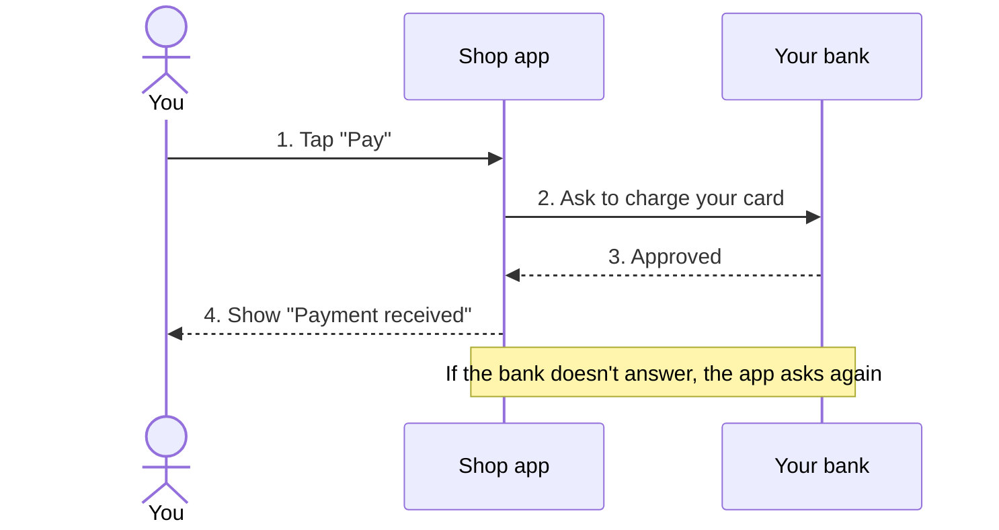
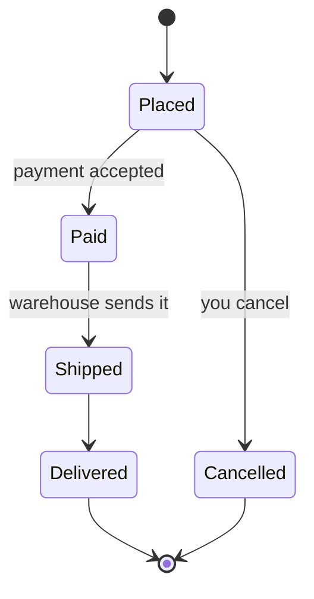
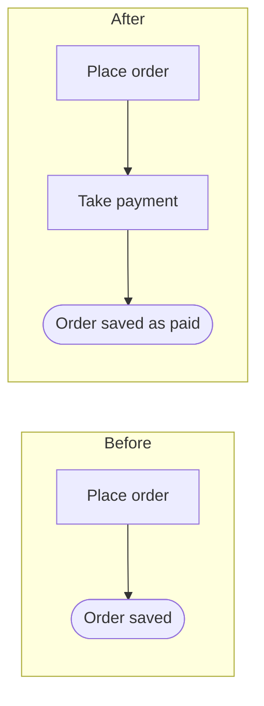
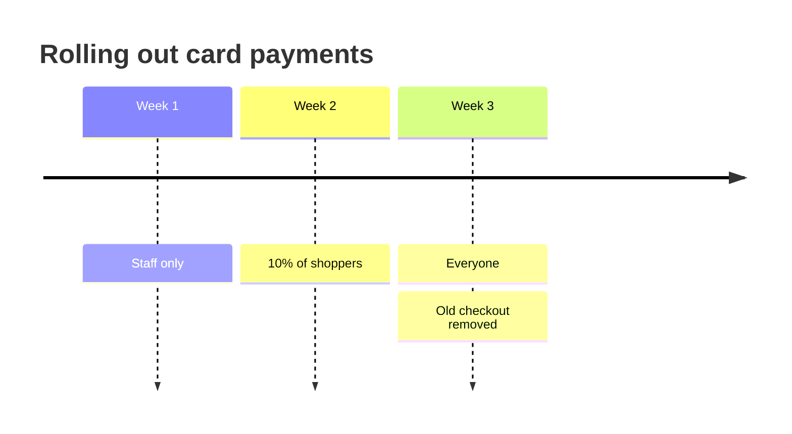
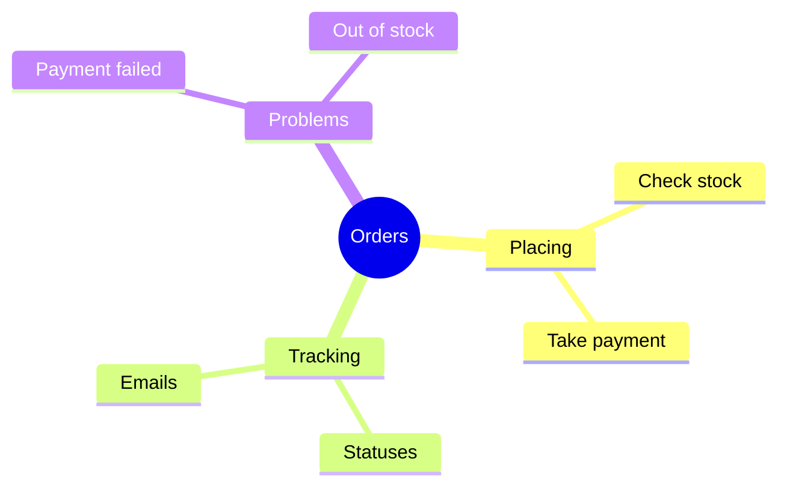
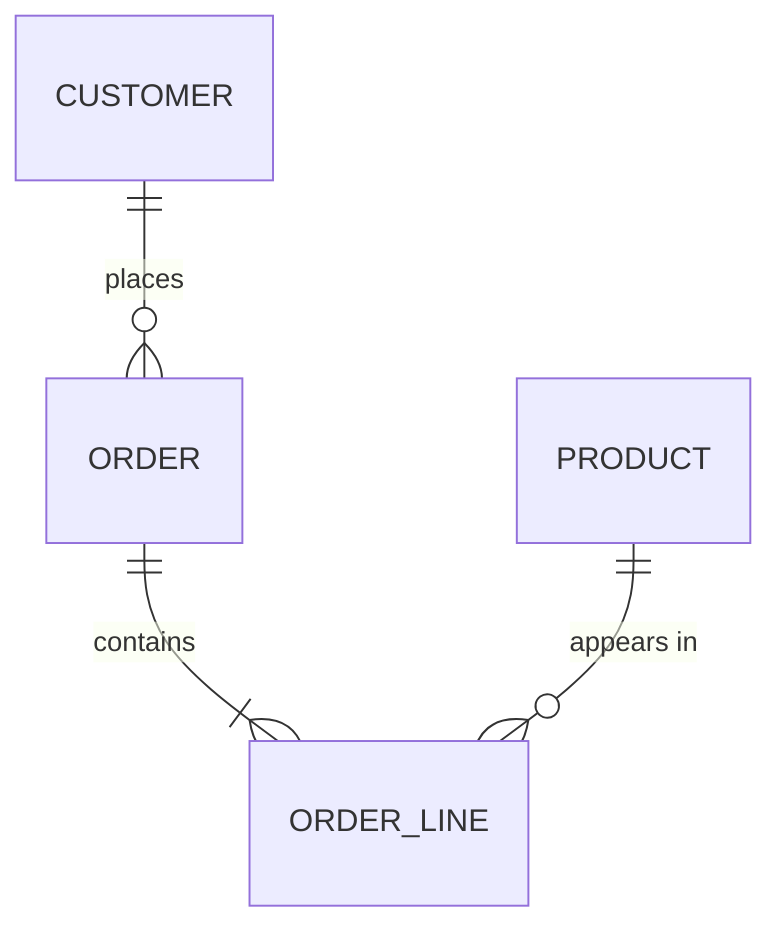
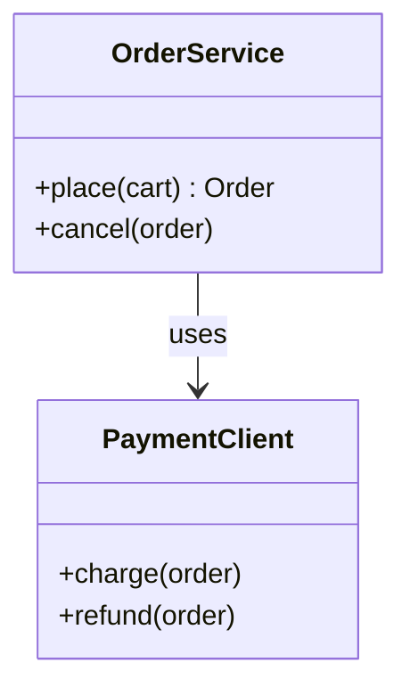

# Diagrams for Documentation

Required reading for SKILL.md Phase 4, "Documentation tasks", step 4. Diagrams
are the core of the document, not decoration: a reader who looks only at the
diagrams and their captions should get the main idea. Write for a newcomer,
end user, operator, or decision maker who has never read the code.

---

## 1. The five-second rule

Every diagram must pass this test: **a reader new to the code gets its point
in five seconds.** These rules make that happen.

1. **Caption = the takeaway, not the topic.** "A failed payment is tried up to
   9 times", not "Payment flow". Write the caption first, then draw only what
   proves it.
2. **One message per diagram.** Two ideas get two diagrams. Start with an
   overview, then zoom in: level 1 shows the whole thing, level 2 shows one
   step from it.
3. **5–9 boxes.** Over nine, split. Under three, use a sentence.
4. **Labels of five words or fewer**, in the reader's words: verbs for steps
   ("Check stock"), short nouns for states ("Shipped"), familiar names for
   people and systems ("You", "Your bank").
5. **Number the steps** in the labels ("1. Tap Pay") so the walkthrough and
   the picture match line by line.
6. **The happy path runs straight down or across.** Errors and edge cases
   branch off to the side.
7. **No crossing lines.** Reorder the boxes or split the diagram.
8. **Highlight the one thing that matters**: a style plus words in the label
   ("⚠ Retried again"). Never use colour alone.
9. **Same shape, same meaning** throughout the document. Use a legend if you
   use more than two shapes.
10. **Caption above or below, numbered walkthrough after.** The walkthrough is
    what screen readers, email previews, and renderers without Mermaid show.

---

## 2. Pick the diagram by the reader's question

Default to drawing. Use a plain list alone only for three or fewer straight-line
steps.

| Reader's question | Diagram | Mermaid | Typical section |
|---|---|---|---|
| "What is this and what does it talk to?" | Context | `flowchart LR` | Big picture |
| "What happens, step by step? What if it fails?" | Flowchart | `flowchart TD` | How it works |
| "Who sends what to whom, in what order?" | Sequence | `sequenceDiagram` | How it works |
| "What statuses can it be in, and how does it move?" | State | `stateDiagram-v2` | States and data |
| "What did this change do?" | Before / after | `flowchart` + `subgraph` | What changed |
| "What happens when, in what order over time?" | Timeline | `timeline` | What changed, rollout, schedules |
| "What are the main ideas and how do they group?" | Mind map | `mindmap` | Summary, glossary |
| "What records exist and how do they relate?" | Data relationships | `erDiagram` | States and data |
| "How is the code organised?" *(maintainers only)* | Class structure | `classDiagram` | Key parts |
| "Which option fits me?" | Comparison table | Markdown table | Usage, choices |

Every document has at least an overview (context diagram, or mind map for a
concept) and one diagram per main flow. Add a state diagram for three or more
statuses and a before/after for any change that alters a flow.

---

## 3. Build it from evidence

A diagram is a claim like any other. Build it from the Findings, not from
memory of how such systems "usually" work.

1. **Trace the flow first.** Anchor on the entry point (route, command, button
   handler) and follow callers and callees one hop at a time, as described in
   `references/discovery-recipes.md`. Each hop you verify is one arrow.
2. **Map each branch to a condition in the code.** A diamond such as "Card
   accepted?" needs a verified `if`/`match`/error path behind it.
3. **Keep an edge table in the evidence pack** (e.g. `doc-result.md`), not in
   the published doc:

   | Edge | Evidence |
   |---|---|
   | Checkout → Payment | [verified] `billing/charge.ts:42` calls `charge()` |
   | Payment fails → Retry | [verified] `billing/charge.ts:57` retries on 5xx |
   | Retry → Email | [inferred] `notify/email.ts` naming only, so left out of the diagram |

4. **Leave out inferred edges**, or draw them dashed (`-.->`) with a caption
   that says they are unconfirmed. Never draw an assumed step as solid.

---

## 4. Rewrite code names as reader labels

| Instead of (code view) | Write (reader view) |
|---|---|
| `AuthFilter.validateJwt()` | Check you're signed in |
| `POST /api/v2/orders` | Send your order |
| `OrderStatus.PENDING_FULFILMENT` | Waiting to ship |
| `RetryPolicy (3x, exp backoff)` | Try again up to 3 times |
| `KafkaProducer.send(OrderCreated)` | Tell the warehouse |

Put the code name in the walkthrough or the Key parts table, never in the box.
Class diagrams for maintainers are the one exception.

---

## 5. Templates

### Context: what it is and what it talks to

````markdown

*The order service sits between you, your bank, and the order records. Dashed: not yet confirmed.*
````

Main part in the middle, callers on the left, dependencies on the right.
`([…])` is a person or start point; `[(…)]` is storage or an outside system.

### Flowchart: steps and decisions

````markdown

*An order is only confirmed after stock and payment both pass.*
````

Shapes: `([…])` start/end, `[…]` step, `{…}` decision. The `classDef` line
highlights one box; keep the meaning in its label too.

### Sequence: who talks to whom

````markdown

*The app checks with your bank before showing that you've paid.*
````

### State: statuses over time

````markdown

*An order can be cancelled only before it is paid.*
````

### Before and after: what a change did

````markdown

*Placing an order now takes payment before saving it.*
````

For changed values or limits, a before/after table is clearer than a diagram.

### Timeline: what happens when

````markdown

*Everyone gets card payments by week 3.*
````

### Mind map: main ideas at a glance

````markdown

*Everything about orders falls into placing, tracking, and problems.*
````

### Data relationships: what records exist

````markdown

*A customer can have many orders; each order lists one or more products.*
````

Read `||--o{` as "one to zero-or-many" and `||--|{` as "one to one-or-many".
Say so in the walkthrough; basic readers won't know the notation.

### Class structure (maintainers only)

````markdown

*`OrderService` does the work; `PaymentClient` is its only route to the bank.*
````

### Plain-text fallback (renderer without Mermaid)

```text
[1. You place an order]
        |
        v
  2. In stock? --no--> "Out of stock"
        | yes
        v
  [3. Take payment] --declined--> "Try another card"
        |
        v
[5. Order confirmed]
```

---

## 6. Mermaid gotchas

| Problem | Fix |
|---|---|
| Label with `()`, `[]`, `{}`, `:` or `"` breaks parsing | Quote it: `A["Pay (card)"]`. Inside, use `#quot;` for a quote |
| Node id `end` (lowercase) breaks a flowchart | Use another id, or capitalise: `End` |
| Long labels stretch the diagram | Shorten, or break with `<br/>` |
| `timeline` or `mindmap` doesn't render | Needs Mermaid 9.4+ (GitHub and GitLab have it); otherwise use a flowchart or a list |
| Mind map indentation is off | Indent with spaces only, consistently; a node's depth is its indentation |
| Target doesn't render Mermaid (some wikis, PDFs, email) | Use the plain-text fallback, or export an SVG/PNG and keep the source next to it |
| Diagram drifts from code after changes | Keep the edge table in the evidence pack; re-check anchors when the code changes |

GitHub, GitLab, Azure DevOps, Obsidian, Docusaurus and MkDocs (with a plugin)
render fenced `mermaid` blocks. Confluence and plain PDFs usually need a plugin
or an exported image. Check the target before choosing.

---

## 7. Verify before calling it done

- **Render check.** If `mmdc` (Mermaid CLI) is available, or allowed via
  `npx -y @mermaid-js/mermaid-cli`, run `mmdc -i doc.md -o doc.rendered.md`. It
  fails on a syntax error and writes an SVG per diagram. The first run
  downloads a browser; set `PUPPETEER_EXECUTABLE_PATH` to an installed Chrome
  to skip that, and ask before downloading in a restricted session. Without it,
  preview in the target renderer, or say the diagram was not render-checked.
- **Trace check.** Walk each arrow against the edge table. Any arrow without a
  `verified` row comes out or turns dashed.
- **Five-second check.** Cover the prose and read only the diagram and caption.
  Is the point obvious? Would someone who has never seen the code get it? If a
  label needs the code to make sense, rewrite it.
- Record what you ran and the result under **Validation** in the evidence pack.
