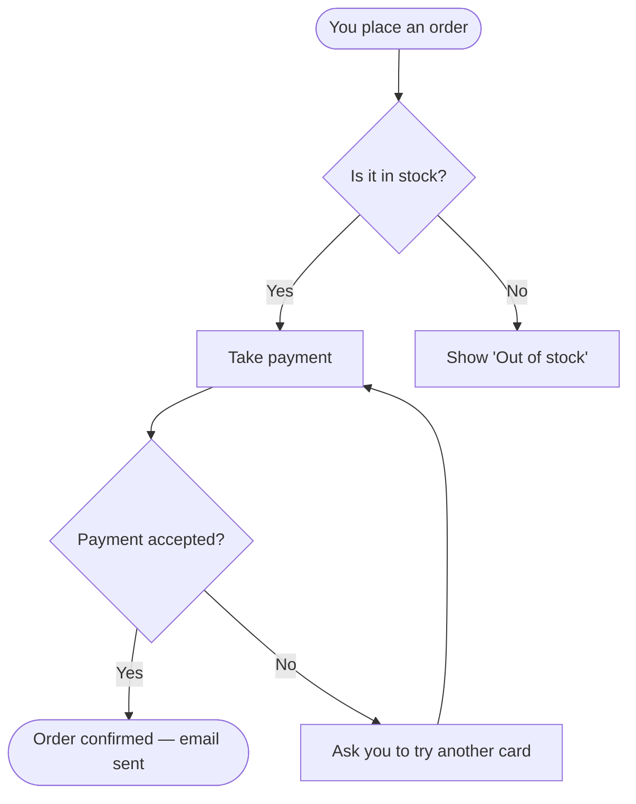
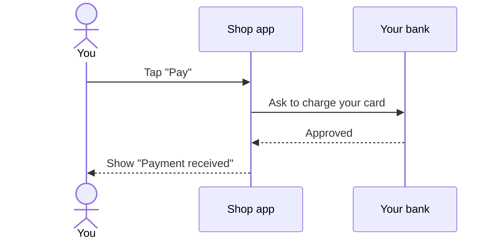
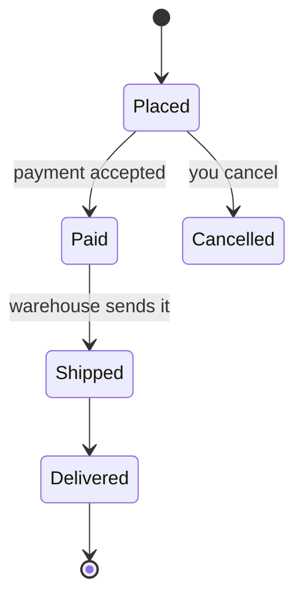

# Diagrams for Basic-User Documentation

Extends SKILL.md Phase 4, "Diagrams for basic-user docs". Use it
when the reader is a newcomer, end user, operator, or decision maker who needs
to follow a flow without reading the code.

---

## 1. Decide whether a diagram earns its place

| The reader must understand… | Draw | Example question |
|---|---|---|
| Steps with yes/no branches | Flowchart | "What happens when I submit an order?" |
| Who sends what to whom, in order | Sequence diagram | "What happens between my app and the payment provider?" |
| How something's status changes over time | State diagram | "Why does my order say *Pending*?" |
| Which parts exist and how they connect | Simple block diagram (flowchart, no branches) | "What does this service talk to?" |
| Five or fewer straight-line steps | **No diagram**, just a numbered list | "How do I reset my password?" |

If two rows apply, draw two small diagrams rather than one big one.

---

## 2. Build it from evidence

A diagram is a claim like any other. Build it from the Findings, not from
memory of how such systems "usually" work.

1. **Trace the flow first.** Anchor on the entry point (route, command, button
   handler) and follow callers and callees one hop at a time, as described in
   `references/discovery-recipes.md`. Each hop you verify is one arrow.
2. **Map each branch to a condition in the code.** A diamond such as "Card
   accepted?" needs a verified `if`/`match`/error path behind it.
3. **Keep an edge table in the evidence pack** (e.g. `doc-result.md`), not in
   the published doc:

   | Edge | Evidence |
   |---|---|
   | Checkout → Payment | [verified] `billing/charge.ts:42` calls `charge()` |
   | Payment fails → Retry | [verified] `billing/charge.ts:57` retries on 5xx |
   | Retry → Email | [inferred] `notify/email.ts` naming only, so left out of the diagram |

4. **Leave out inferred edges**, or draw them dashed (`-.->`) with a caption
   that says they are unconfirmed. Never draw an assumed step as solid.

---

## 3. Write labels a basic user understands

| Instead of (code view) | Write (reader view) |
|---|---|
| `AuthFilter.validateJwt()` | Check you're signed in |
| `POST /api/v2/orders` | Send your order |
| `OrderStatus.PENDING_FULFILMENT` | Waiting to ship |
| `RetryPolicy (3x, exp backoff)` | Try again up to 3 times |
| `KafkaProducer.send(OrderCreated)` | Tell the warehouse |

Rules:

- Use verbs for steps ("Check stock") and short noun phrases for states
  ("Shipped").
- Name people and outside systems the way the reader knows them: "You", "Your
  bank", not "Client" or "PSP".
- About nine boxes at most, labels of about five words at most. Over that, split
  into an overview diagram and a detail diagram.
- Follow the order people read in: top to bottom (`TD`) for a process, left to
  right (`LR`) for a pipeline or timeline.
- Mark the happy path first; put error paths on the side.
- Don't use colour alone to carry meaning. Where colour matters, say it in the
  label too ("Failed").

---

## 4. Templates

### Flowchart: steps and decisions

````markdown

*How an order goes from checkout to confirmation.*
````

Shapes: `([…])` start/end, `[…]` step, `{…}` decision.

### Sequence diagram: who talks to whom

````markdown

*What happens behind the scenes when you pay.*
````

### State diagram: status over time

````markdown

*The statuses an order moves through.*
````

### Plain-text fallback (renderer without Mermaid)

```text
[You place an order]
        |
        v
  In stock? --no--> "Out of stock"
        | yes
        v
  [Take payment] --declined--> "Try another card"
        |
        v
[Order confirmed]
```

---

## 5. Always pair the diagram with words

Under every diagram, add:

1. **A one-line caption** saying what the picture shows.
2. **A short numbered walkthrough** of the same steps in plain sentences.

The walkthrough is what screen readers, email previews, and renderers without
Mermaid show. If the diagram and the walkthrough disagree, the doc is wrong.

---

## 6. Mermaid gotchas

| Problem | Fix |
|---|---|
| Label with `()`, `[]`, `{}`, `:` or `"` breaks parsing | Quote it: `A["Pay (card)"]`. Inside, use `#quot;` for a quote |
| Node id `end` (lowercase) breaks a flowchart | Use another id, or capitalise: `End` |
| Long labels stretch the diagram | Shorten, or break with `<br/>` |
| Target doesn't render Mermaid (some wikis, PDFs, email) | Use the plain-text fallback, or export an SVG/PNG and keep the source block next to it |
| Diagram drifts from code after changes | Keep the edge table in the evidence pack; re-check the anchors when the code changes |

GitHub, GitLab, Azure DevOps, Obsidian, Docusaurus and MkDocs (with a plugin)
render fenced `mermaid` blocks. Confluence and plain PDFs usually need a plugin
or an exported image. Check the target before choosing.

---

## 7. Verify before calling it done

- **Render check.** If `mmdc` (Mermaid CLI) is available, or allowed via
  `npx -y @mermaid-js/mermaid-cli`, run it:
  `mmdc -i doc.md -o doc.rendered.md`. It fails on a syntax error and writes an SVG
  for each diagram. The first run downloads a browser, so ask before using it in
  a restricted session. Without it, preview in the target renderer, or say that
  the diagram was not render-checked.
- **Trace check.** Walk each arrow against the edge table. Any arrow without a
  `verified` row comes out or turns dashed.
- **Reader check.** Read only the labels. Can someone who has never seen the
  code tell what happens, in order? If a label needs the code to make sense,
  rewrite it.
- Record what you ran and the result under **Validation** in the evidence pack.
